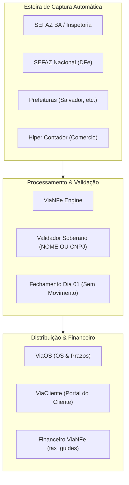
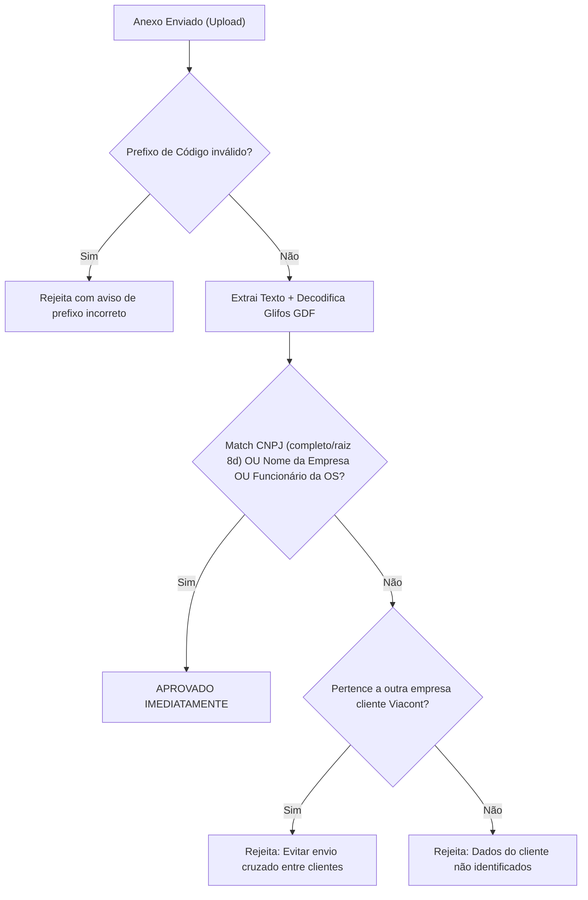

# Playbook Operacional do Setor Fiscal — Viacont Contabilidade

> **Classificação**: Documento Institucional Interno  
> **Versão**: 2.0 (Atualizada em Novembro/2026)  
> **Responsáveis**: Diretoria Executiva (Augusto & Val) e Coordenação Fiscal/Sistemas  

---

## 1. Visão Geral da Arquitetura Fiscal

O Setor Fiscal da Viacont opera de forma totalmente integrada com as plataformas proprietárias:
- **ViaOS**: Sistema operacional de Ordens de Serviço, prazos e controle de entregas fiscais.
- **ViaNFe**: Central de inteligência fiscal, captura contínua SEFAZ/Prefeituras, emissão segura e gestão de guias com PIX.
- **ViaCliente (`cliente.viacont.com.br`)**: Portal e app móvel do cliente para visualização e pagamento de guias tributárias.

---

## 2. Rotinas Operacionais do Mês

### 2.1 Rotina do Dia 01: Fechamento de Empresas Sem Movimento
No **dia 01 de cada mês**, o sistema realiza a varredura automática de faturamento para as empresas listadas como sem movimento contínuo:
1. `Canda e França`
2. `JN Santos`
3. `JS Limpeza`
4. `NN Engenharia`
5. `Nutrilife`
6. `RF Tour`
7. `Soultero`
8. `Trend Energia`

**Procedimento Operacional:**
1. A IA/Robô verifica no banco se houve emissão de NF-e, NFC-e ou NFS-e no mês de competência anterior.
2. Confirmada a inexistência de documentos fiscais emitidos, gera o documento oficial:  
   `Declaração de Inexistência de Movimento Fiscal — Competência MM/AAAA`.
3. O relatório é arquivado automaticamente na pasta do cliente (`SETOR FISCAL/DECLARACOES_SEM_MOVIMENTO/`) e o slot da respectiva OS no ViaOS é preenchido e concluído.

---

### 2.2 Rotina de ISS Municipal dos Lucros Presumidos (Prestadores de Serviços)
Para clientes prestadores de serviços no regime de Lucro Presumido (ex.: AMSFER e correlatos):

**Procedimento de Captura:**
1. **Autenticação Segura**: Conexão aos portais municipais (SEFAZ Salvador `nfse.salvador.ba.gov.br`, Lauro de Freitas, etc.) utilizando Certificado Digital A1 da Viacont ou Procuração Eletrônica.
2. **Apuração da DMS**: Conferência dos serviços prestados e tomados.
3. **Emissão do DAM**: Extração da guia de ISSQN com código de barras e data de vencimento.
4. **Sincronização**: O PDF do DAM é alimentado simultaneamente no ViaOS, no ViaCliente (`guias_pagar`) e no Financeiro do ViaNFe (`tax_guides`).

---

### 2.3 Rotina de Comércio Varejista (Hiper Contador & SEFAZ)
Para comércios de móveis, eletro e restaurantes (Bom Todo, Conceição da Feira, JL Peças, Churrascaria Tradição Gaúcha):
1. **Captura Diária/Semanal**: Sincronização via SEFAZ Nacional/Estadual das notas modelo 55 e download dos lotes de cupons fiscais modelo 65 no Hiper Contador.
2. **Achatamento de Diretórios**: Todas as notas são salvas sem subpastas recursivas em `SETOR FISCAL/NFCe/` e `SETOR FISCAL/NFe/`.

---

## 3. Protocolo de Validação de Anexos e Trava de Segurança

O ViaOS adota a **Regra Mestra Disjuntiva**:

> **Regra de Ouro**: A comprovação da legitimidade do anexo dá-se **POR NOME OU POR CNPJ MATCH**.

### Características Técnicas do Validador:
1. **Decodificação de Glifos FGTS Digital (GDF / Conectividade Social)**: O motor de extração converte o mapa proprietário de caracteres embutidos da Caixa/Gov.br diretamente em texto legível (`+ & 7 2 &` -> `FARMACIA`, `( - : 7 7 & 8` -> `CHURRASCARIA`).
2. **Inspeção no Nome do Arquivo (`nomeArquivo`)**: Palavras distintivas ou raízes de CNPJ presentes no título do arquivo garantem conformidade imediata.
3. **Imunidade de Órgãos Oficiais**: Viacont (procurador padrão), Caixa Econômica, Bancos e Receita Federal nunca são tratados como empresas concorrentes/conflitantes.
4. **Padronização de Tarefas de Admissão**: Unificação de todos os procedimentos de admissão no **Template 65** (`ADMISSÃO DE FUNCIONÁRIO`), que contempla a lista completa dos 6 documentos regulamentares.

---

## 4. Esteira Tripla de Guias e Pagamentos

Para assegurar que o cliente nunca deixe de receber ou pagar uma guia no vencimento:

| Plataforma | Destino | Função |
| :--- | :--- | :--- |
| **ViaOS** | Operador & Tarefa | Controle do prazo de entrega, responsabilidade do analista e protocolo auditado. |
| **ViaCliente** | Cliente Final | Visualização no App/Web (`cliente.viacont.com.br`), download do PDF, código de barras e PIX Copia-e-Cola. |
| **ViaNFe** | Gestão & Financeiro | Tabela `tax_guides`, provisão para conciliação bancária e DRE fiscal. |

---

## 5. Diretrizes de Segurança da Informação

- **Sigilo Absoluto de Senhas**: Credenciais de certificados digitais e acessos tributários são estritamente cifradas (AES-256). É expressamente proibido expor senhas em texto puro em logs, telas ou relatórios.
- **Trilha de Auditoria**: Todo anexo, aprovação, download ou notificação por WhatsApp/E-mail possui registro indelével de IP, data/hora e hash SHA-256.
