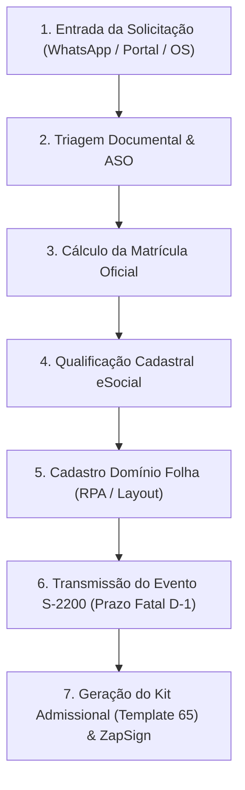

# Roteiro Mestre do Robô: Fluxo de Admissão de Funcionário para Qualquer Empresa

> **Classificação**: Protocolo Operacional Canônico — Setor Pessoal Viacont  
> **Versão**: 2.0 (Homologada em Novembro/2026)  
> **Aprovado por**: Augusto Oliveira e Val (Diretoria Executiva)  
> **Integração**: Domínio Sistemas, eSocial, ViaOS (Template 65), ZapSign e Viviane AI  

---

## 1. Visão Geral da Esteira de Admissão

A admissão de um funcionário em **qualquer empresa cliente da Viacont** segue rigorosamente 7 etapas encadeadas, eliminando retrabalho, multas do eSocial e falhas cadastrais.



---

## 2. As 7 Etapas Canônicas de Admissão

### Etapa 1: Recepção da Demanda e Abertura da OS
1. A solicitação pode ingressar via:
   - Formulário do **ViaCliente** (`cliente.viacont.com.br`).
   - WhatsApp da **Viviane AI** (`5575992007979`).
   - Abertura direta no **ViaOS**.
2. **Abertura da Ordem de Serviço**:
   - A OS é criada vinculada ao **Template 65 (`ADMISSÃO DE FUNCIONÁRIO`)**.
   - Título padronizado: `ADMISSÃO DE FUNCIONÁRIO — [NOME DO EMPREGADO]`.
   - Se o pedido vier duplicado via WhatsApp, os dados são consolidados na OS oficial existente e o status é definido como `EM_ANDAMENTO`.

---

### Etapa 2: Triagem Documental & Atestado Médico (ASO)
O robô/analista deve conferir a presença dos seguintes arquivos na pasta do cliente:
`CLIENTES ATIVOS/[EMPRESA]/SETOR PESSOAL/FUNCIONARIO/[NOME_FUNCIONARIO]/DOCUMENTOS/`

1. **Documento de Identidade**: RG, CNH válida ou Passaporte.
2. **CPF**: Situação regular na Receita Federal.
3. **CTPS Digital**: Espelho emitido pelo aplicativo Carteira de Trabalho Digital (PDF).
4. **Comprovante de Residência**: Conta de consumo com até 90 dias de emissão.
5. **Título de Eleitor**: Regular na Justiça Eleitoral.
6. **Certificado de Reservista / Alistamento**: Obrigatório para homens entre 18 e 45 anos.
7. **Certidão de Nascimento/Casamento dos Dependentes**:
   - Filhos menores de 14 anos: exige certidão de nascimento + cartão de vacinação (até 6 anos) + comprovante de frequência escolar (a partir de 7 anos) para direito ao Salário Família.
8. **ASO Admissional (Atestado de Saúde Ocupacional)**:
   > [!IMPORTANT]
   > O ASO deve ter resultado expressamente **"APTO"** e sua data de emissão deve ser **anterior ou igual à data de início das atividades**. É expressamente vedada a admissão sem ASO prévio (NR-7 / CLT Art. 168).

---

### Etapa 3: Cálculo da Matrícula Oficial Viacont
A matrícula do empregado é calculada compulsoriamente pela **Fórmula Mestre Homologada**:

$$\mathbf{Matrícula} = \mathbf{3\text{ primeiros dígitos do CPF}} + \mathbf{\text{Código da Empresa no Domínio}}$$

* **Exemplo Prático 1:**
  - Empregado: Fábio Oliveira Nogueira (CPF `097.653.915-28`)
  - Empresa: JL Peças / Fogões (Código Domínio `42`)
  - **Matrícula:** `09742`
* **Exemplo Prático 2:**
  - Empregado: Silvany Oliveira de Sousa (CPF `048.xxx.xxx-xx`)
  - Empresa: Churrascaria Tradição (Código Domínio `13`)
  - **Matrícula:** `04813`

> [!CAUTION]
> Jamais utilizar sequenciais genéricos do Domínio (ex.: 0001, 0002). Essa matrícula é a chave primária que amarra o Domínio Folha, o eSocial e o Kit Contratual.

---

### Etapa 4: Qualificação Cadastral no eSocial
Antes de cadastrar, o robô ou analista consulta o portal de Qualificação Cadastral do eSocial:
- Validação cruzada: **CPF + Nome Completo + Data de Nascimento + NIS/PIS**.
- Se houver divergência (ex.: nome de solteiro desatualizado), o processo entra em pendência para regularização pelo empregado antes da transmissão.

---

### Etapa 5: Cadastramento no Domínio Sistemas
O robô executor (`DESKTOP-UFMKDHU`) consome a fila de trabalho:
1. Localiza a empresa pelo seu **Código Domínio**.
2. Preenche os dados contratuais:
   - **Matrícula**: Matrícula calculada na Etapa 3.
   - **Data de Admissão**: Data acordada (ex.: 16/11/2026).
   - **Cargo & CBO**: Classificação Brasileira de Ocupações oficial.
   - **Salário Base**: Valor contratual e tipo (Mensalista, Horista, Comissionista).
   - **Jornada de Trabalho**: Escala de trabalho, carga horária semanal e intervalos de descanso.
   - **Opção de Vale Transporte**: Com indicação do desconto legal de até 6%.
   - **Contrato de Experiência**: Padrão 45 + 45 dias ou 30 + 60 dias (máximo legal de 90 dias, Art. 445 CLT).

---

### Etapa 6: Transmissão do Evento ao eSocial (Prazo Fatal Legal)
1. **Evento S-2200 (Cadastramento Inicial e Admissão)**:
   - Transmissão do XML para o ambiente nacional do eSocial.
2. **Prazo Legal Estrito**:
   > [!WARNING]
   > O evento de admissão deve ser transmitido **até as 23:59 do dia imediatamente anterior ao início das atividades do trabalhador** (Portaria MTP e Art. 47 da CLT). Em caso de urgência onde faltem dados complementares, deve-se transmitir o **Evento S-2190 (Admissão Preliminar)** dentro do prazo, completando com o S-2200 posteriormente.
3. **Recibo de Transmissão**:
   - Salvar o comprovante oficial com o número do recibo eSocial no slot 160 da OS.

---

### Etapa 7: Geração do Kit Admissional (Template 65 do ViaOS) & Assinatura
O robô gera o Kit Contratual completo preenchendo as 6 posições de entrega do ViaOS:

| Slot | Documento Oficial | Finalidade |
| :---: | :--- | :--- |
| **156** | **Ficha Registro de Empregado** | Documento oficial de identificação e registro laboral da empresa. |
| **157** | **Contrato de Experiência** | Contrato bilateral com prorrogação e acordo de compensação de horas. |
| **158** | **Termo de Opção / Dispensa de VT** | Manifestação expressa do uso ou recusa do Vale Transporte. |
| **159** | **Ficha de Salário Família** | Cadastro de dependentes e termo de responsabilidade de vacinação/escola. |
| **160** | **Comprovante de Envio eSocial** | Recibo de entrega do Evento S-2200 / S-2190. |
| **161** | **ASO Admissional (Apto)** | Atestado médico ocupacional emitido por médico do trabalho. |

#### Coleta de Assinaturas:
1. O kit é enviado via **ZapSign** para assinatura eletrônica do representante legal da empresa e do colaborador.
2. A **Viviane AI** notifica o cliente pelo WhatsApp e envia cópia por e-mail com link de acesso rápido ao **ViaCliente**.
3. Uma vez assinado, a tarefa é encaminhada para aprovação da diretoria (`Val` ou `Augusto`) e concluída.

---

## 3. Resumo Mnemônico para o Robô (Prompt de Execução)

```text
AO RECEBER UMA ADMISSÃO EM QUALQUER EMPRESA:
1. Verifique se existe OS aberta; se não houver, crie no Template 65 do ViaOS.
2. Confira o ASO: tem que ser "APTO" e com data <= data de admissão.
3. Calcule a matrícula: 3 primeiros dígitos do CPF + Código Domínio da empresa.
4. Execute a qualificação cadastral no eSocial.
5. Cadastre no Domínio Folha com CBO, salário, jornada e a matrícula calculada.
6. Transmita o S-2200 ao eSocial até o dia anterior ao início do trabalho.
7. Gere os 6 documentos do Template 65 e dispare para assinatura digital via ZapSign.
```
